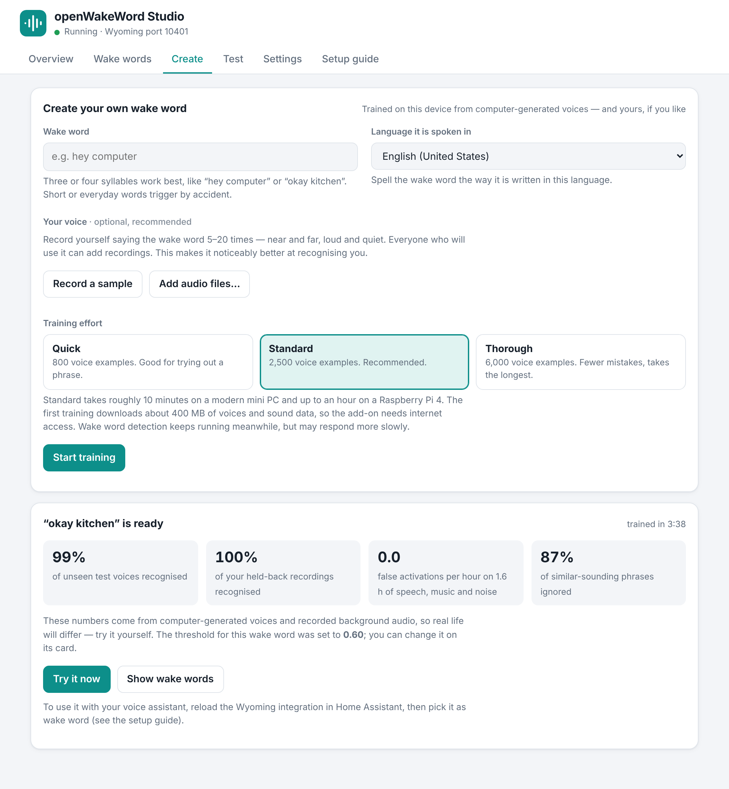
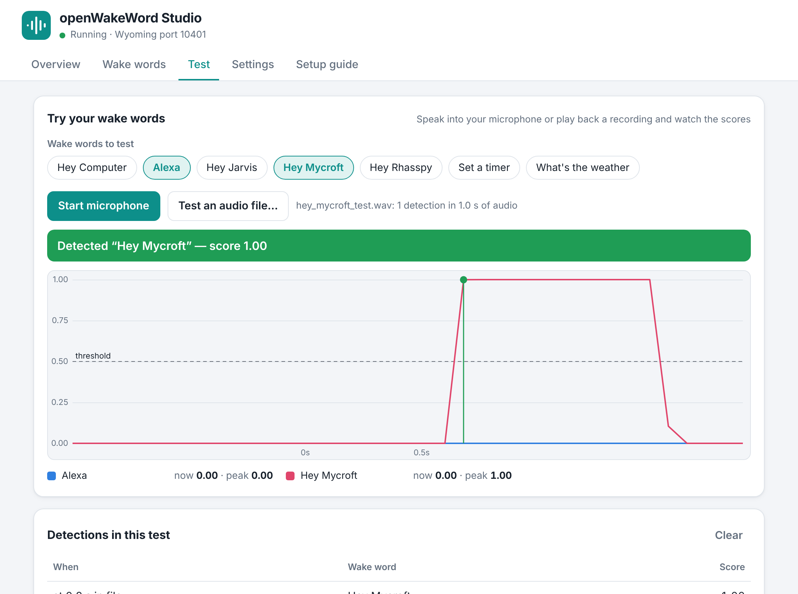
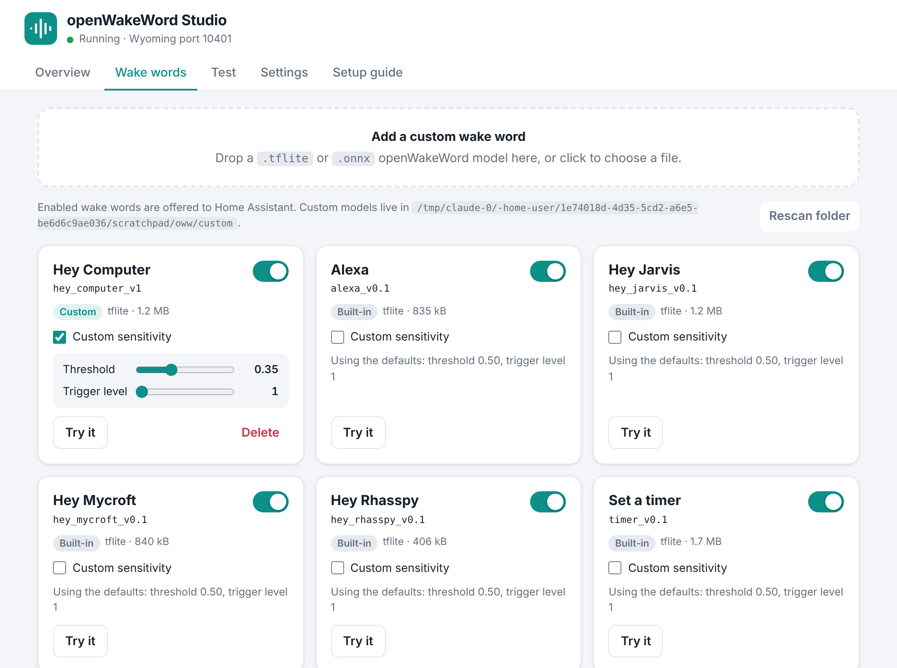

# openWakeWord Studio — Home Assistant add-on

A Home Assistant add-on that runs [openWakeWord](https://github.com/dscripka/openWakeWord)
as a Wyoming wake word service **and** gives it a friendly web UI: switch wake
words on and off, **train your own wake word on the device**, upload custom models, test them with your microphone or an
audio file while watching live scores, and tune sensitivity without touching YAML.







## Install

1. Push this repository to GitHub and set your URL in `repository.yaml`.
2. In Home Assistant: **Settings → Add-ons → Add-on Store → ⋮ → Repositories**,
   add the repository URL.
3. Install **openWakeWord Studio**, start it, and open **Wake Words** in the sidebar.

To try it without GitHub, copy the `openwakeword_studio` folder into
`/addons/` on your Home Assistant machine (Samba or SSH add-on), then
**Add-on Store → ⋮ → Check for updates** and install it from *Local add-ons*.

The first install builds the image on your machine and takes a few minutes.

See [openwakeword_studio/DOCS.md](openwakeword_studio/DOCS.md) for usage.

## Layout

```
repository.yaml               add-on repository metadata
openwakeword_studio/
  config.yaml  Dockerfile     add-on definition and image
  app/                        Python service
    __main__.py               startup, Supervisor discovery
    engine.py                 streaming detection on top of openwakeword.Model
    trainer.py                on-device wake word training (Piper + NumPy)
    wyoming_server.py         Wyoming protocol (port 10400)
    web.py                    REST + WebSocket API (ingress, port 8099)
    registry.py settings.py hub.py
    static/                   the web UI (plain HTML/CSS/JS, no build step)
tests/                        end-to-end tests
```

## Develop

```bash
python3.12 -m venv .venv && . .venv/bin/activate
pip install -r openwakeword_studio/requirements.txt pytest pytest-asyncio \
  "openwakeword @ https://github.com/dscripka/openWakeWord/archive/368c03716d1e92591906a84949bc477f3a834455.tar.gz"
python -c "from openwakeword.utils import download_models; download_models()"

# run locally: UI on http://localhost:8099, Wyoming on 10400
cd openwakeword_studio
STUDIO_DATA_DIR=/tmp/studio STUDIO_CUSTOM_DIR=/tmp/studio/models python -m app

# tests (the WAV comes from the openWakeWord repository: tests/data/alexa_test.wav)
OWW_TEST_WAV=/path/to/alexa_test.wav pytest
```
